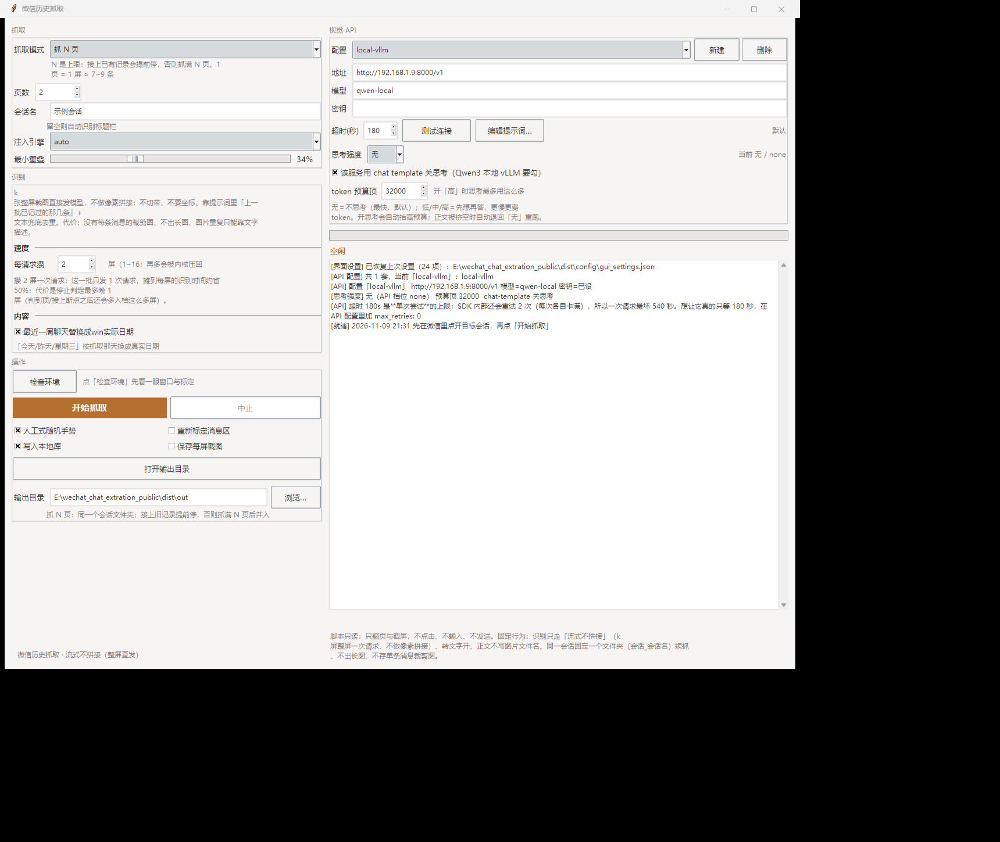
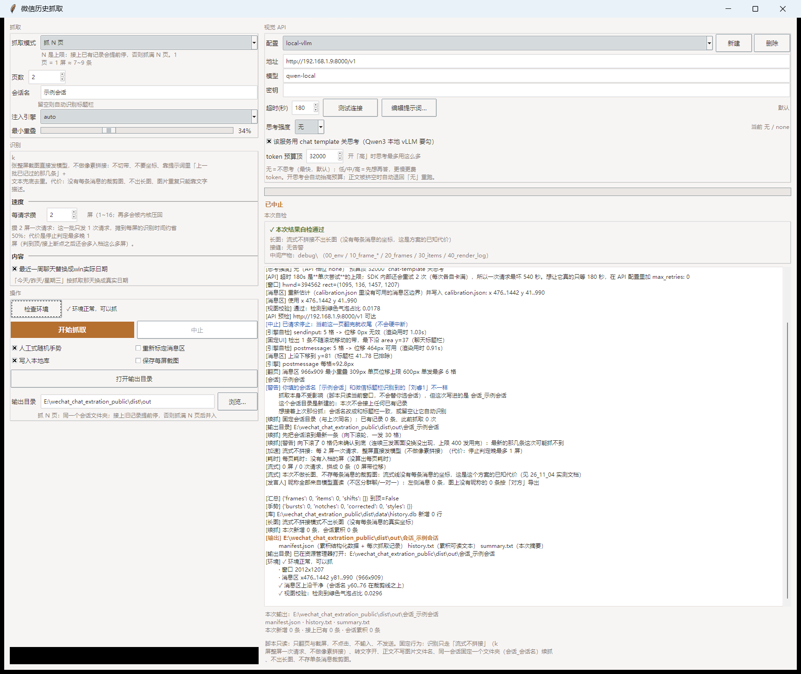
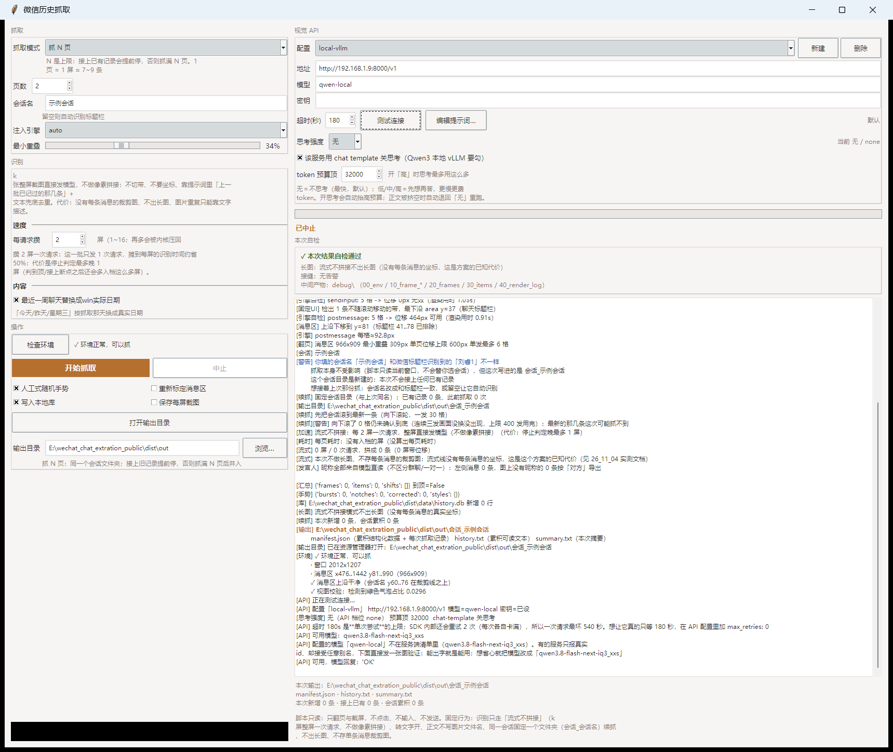
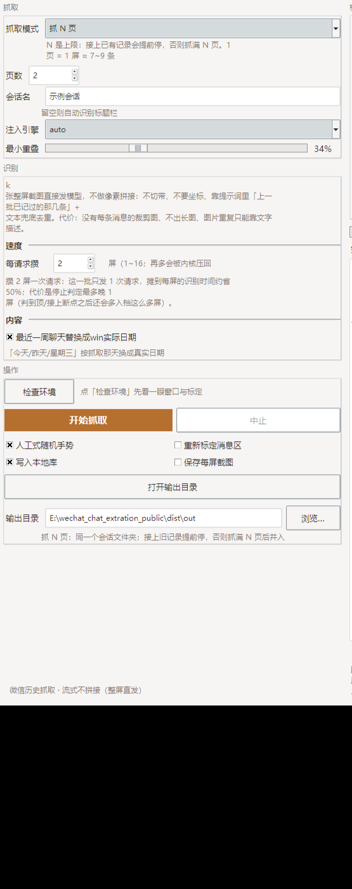
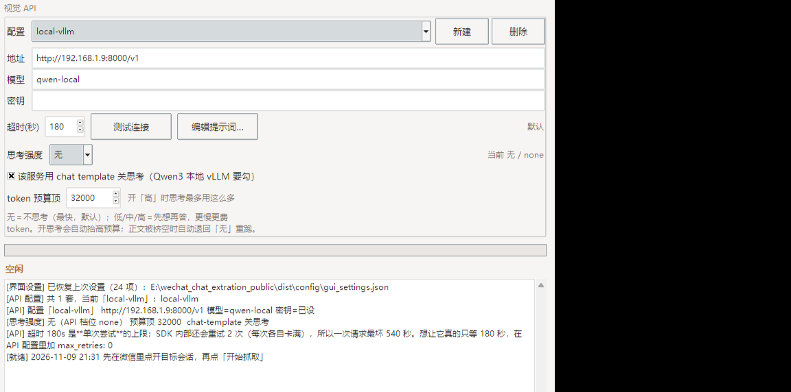
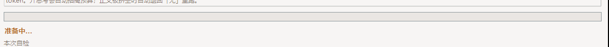
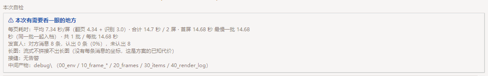

# WeChat Chat Extraction

纯视觉的微信聊天记录导出工具：截图 + 视觉大模型识别文字。**不解密微信数据库、不注入微信进程、不发消息**，截图只发往你自己指定的模型 API。

单文件 exe，免安装，不需要 Python。

---

## 它是什么，不是什么

| 是 | 不是 |
|----|------|
| 把微信窗口里**已经显示出来**的历史记录翻出来、认成文字、存成 txt/json | 解密微信本地 SQLite 数据库的工具 |
| 只滚动、只截图、只读 | 自动回复 / 自动发消息的机器人 |
| 截图发往**你自己**填的 API 地址 | 把数据上传到作者的服务器 |

因为不碰加密数据库，这条路没有「破解」那层法律与封号风险；代价是速度与准确率取决于视觉模型，比解密派慢。

## 工作原理

```
微信窗口 → 自动翻页 → 逐屏截图 → 视觉模型识别 → 去重拼接 → 本地导出
```

1. 找到微信窗口，标定「消息区」的像素范围（头部栏会被排除，不会被切成一条消息）
2. 用滚轮往上翻，每翻一屏截一张整屏图；翻页位移用图像剖面实测，不是猜固定步长
3. 攒够 N 屏一次性发给视觉模型，模型直接返回这一批的结构化条目
4. 按文本 + 位置去重、接上两屏之间的重叠带，落到同一个会话目录

识别链路只有一条：**流式不拼接（整屏直发）**。界面上没有第二个选项。

---

## 下载

从 [Releases](https://github.com/qdnqtao/wechat-chat-extraction/releases/tag/v1.0.0) 下载 `WeChatChatExtraction.exe`（约 64 MB，单文件）。

变更记录见 [RELEASE_NOTES.md](RELEASE_NOTES.md)。

### 环境要求

- Windows 10 / 11
- 微信 PC 桌面版
- 一个**支持图片输入**的视觉大模型 API（本地 vLLM、或任何 OpenAI 兼容端点）

### 微信客户端准备（很重要）

识别质量几乎完全取决于画面可读性：

- **背景颜色保持微信默认色（浅色主题）**。切到深色/夜间模式会让识别率明显下降，这是最常见的失败原因
- 字体大小用默认值，不要缩到很小
- 微信窗口不要最小化；建议宽度 ≥ 800 px，太窄会截断气泡
- 先在微信里点开你要导出的那个会话，再回到本工具

---

## 第一次跑通



1. 把 exe 放进一个**可写**的目录，双击运行。
2. 首次启动会在 **exe 同目录**生成 `config/`。注意：exe 读的是**它自己旁边**的 `config/`，不是别处的同名文件夹。
3. 在右侧「视觉 API」里填地址、模型、密钥（也可以直接编辑 `config/api_profiles.json` 后重启）。
4. 点 **测试连接** —— 它会先拉 `/models` 清单，再真发一张图验证模型能不能认字。
5. 点 **检查环境** —— 确认微信窗口找得到、消息区标定正常。
6. 微信里打开目标会话，回到工具点 **开始抓取**。

### 检查环境



按钮右边给一句结论（`✓ 环境正常，可以抓` 或带 `⚠` 的告警），逐条明细写在下方日志框里。

### 测试连接



日志里会列出服务端真实模型 id。你填的模型名不在清单里不等于不能用：有些服务只报真实 id 却接受别名，工具会直接发一张图验证，能出字就是能用。

---

## 界面参数逐项说明



### 抓取

| 控件 | 范围 / 默认 | 作用 |
|------|-------------|------|
| **抓取模式** | 续抓到接点/到顶（默认）、抓 N 页、抓到指定日期 | 决定翻到哪里停，见下一节 |
| **页数** | 1 ~ 3000，默认 100 | 只在「抓 N 页」下生效，是**上限**不是目标 |
| **目标日期** | `YYYY-MM-DD` | 只在「抓到指定日期」下生效 |
| **会话名** | 文本，默认空 | 决定输出文件夹名。**留空则自动识别微信标题栏** |
| **注入引擎** | `auto`（默认）/ `postmessage` / `sendinput` | 滚轮怎么送进微信，见下 |
| **最小重叠** | 0.15 ~ 0.70，默认 34% | 相邻两屏必须重叠多少。太小会接错，太大会翻不动 |

**三种抓取模式**

- **续抓到接点/到顶**：从最新一条往上翻，接上上次已有的记录就停；翻到顶也停。适合「每次补最近新出的那些」。
- **抓 N 页**：N 是上限。接上已有记录会提前停，否则抓满 N 页。`1 页 = 1 屏 ≈ 7~9 条`。适合「先试抓一小段看看效果」。
- **抓到指定日期**：翻到该日期为止。若已有记录比它更新，以已有记录为准（不会重复抓中间那段）。

**注入引擎怎么选**

- `auto`：先试 `sendinput`（最像真人），如果光标落点不在微信窗口上就自动跳过，改用 `postmessage`。
- `sendinput`：走系统输入队列，需要光标停在微信上。**本工具窗口盖住微信时它会被跳过**。
- `postmessage`：把滚轮消息直接塞进微信的消息队列，不需要前台、不需要光标位置。遮挡严重时手动选这个最稳。

### 识别

| 控件 | 范围 / 默认 | 作用 |
|------|-------------|------|
| **每请求攒 N 屏** | 1 ~ 16，默认 4 | 攒几屏截图合成一次请求 |
| **最近一周聊天替换成 win 实际日期** | 默认开 | 把「今天 / 昨天 / 星期三」换成抓取当天的真实日期 |

攒屏数是个纯权衡：攒 4 屏意味着这一批只发 1 次请求，摊到每屏的识别时间大约省 75%；代价是**停止判定最多晚 N 屏** —— 判到顶或接上断点之后，还会把这一批剩下的屏一并入档。屏数太多还会撞 token 预算硬顶，识别会被掐掉。

### 操作

| 控件 | 默认 | 作用 |
|------|------|------|
| **检查环境** | — | 只读自检：找微信窗口、标定消息区 |
| **开始抓取 / 中止** | — | 中止随时可点，内核每一页、每一次注入前都会查停止标志 |
| **人工式随机手势** | 开 | 翻页用不规则的滚轮节奏（长短不一、偶尔停顿），而不是一刀一个步长 |
| **重新标定消息区** | 关 | 勾上会强制重新估计消息区。换了微信窗口尺寸或布局时用一次 |
| **写入本地库** | 开 | 同时写进 `data\history.db` |
| **保存每屏截图** | 关 | 勾上会把每一屏的原始截图存下来（占空间，排查识别问题时开） |
| **打开输出目录 / 输出目录 / 浏览…** | 默认 `<exe 所在目录>\out` | 输出根目录 |



### 视觉 API

| 控件 | 范围 / 默认 | 作用 |
|------|-------------|------|
| **配置** | 下拉 + 新建 / 删除 | 多套配置整体切换，避免「A 的密钥配 B 的地址」 |
| **地址** | OpenAI 兼容 base，含 `/v1` | 例：`http://127.0.0.1:8000/v1` |
| **模型** | 文本 | 服务端模型 id 或别名 |
| **密钥** | 文本，显示为掩码 | 本地服务可留空 |
| **超时(秒)** | 5 ~ 600，默认 90 | **单次尝试**的上限。SDK 内部还会重试，最坏是超时的数倍；想严格只等这么久，在 `api_profiles.json` 里加 `"max_retries": 0` |
| **测试连接 / 编辑提示词…** | — | 提示词可以整套覆盖默认值 |
| **思考强度** | 无（默认）/ 低 / 中 / 高 | 开思考更慢更费 token |
| **该服务用 chat template 关思考** | 默认关 | Qwen3 这类本地 vLLM **要勾**，否则思考关不掉 |
| **token 预算顶** | 1024 ~ 200000，默认 32000 | 思考与正文共用这一份预算 |

思考强度这三项是一套联动逻辑：开思考会自动抬高预算；如果思考把正文挤空（返回里没有消息），工具会自动退回「无」重跑一次。识别截图这种活，默认「无」通常就是最优解。

---

## 抓取过程长什么样



进度条和状态行在右侧面板中部，下面那块日志框逐行写清每一步：用的哪个引擎、每格实测多少像素、这一页实际位移多少、置信度多少、这一批判了几条。

日志示例（会话名已脱敏）：

```
[引擎自检] sendinput 跳过：光标落点 (923, 458) 不在微信上
[引擎自检] postmessage: 5 格 -> 位移 464px 可用 (渲染用时 1.05s)
[消息区] 标定上沿 y=41 落在聊天头部栏内，按会话名底边 +3 收到 y=100
[引擎] postmessage 每格≈92.8px
[翻页] 消息区 966x890 最小重叠 302px 单页位移上限 588px 单发最多 6 格
[会话] <会话名>
[翻页] 注入 +4 格 -> 位移 +295px 累计 295/543px 剖面+带投票一致 (6 票) 置信度 1.00
[校准] 按本页实测校准 93px -> 86px
[流式] 批 0-1 (2 屏)
[页 0] 流式 10 条: 时间线到 2026-11-09 21:38
[耗时] 平均 7.34 秒/屏 (翻页 4.34 + 识别 3.0)
[流式] 2 屏 / 1 次请求, 拼成 16 条
[发言人] 左侧消息 8 条, 图上没有昵称的 8 条按「对方」导出
[库] data\history.db 新增 16 行
```

### 本次自检



抓完之后右侧会出现「本次自检」，把几件不看就会踩坑的事摆出来：每页耗时、发言人识别覆盖率、长图与接缝告警、debug 目录里有什么。

---

## 输出产物

GUI 的三种模式都会写进**同一个固定目录**（不会每次开一个新文件夹）：

```
out\会话_<会话名>\
├── history.txt        完整记录，按时间排序
├── summary.txt        这次抓了多少屏/多少条、耗时、引擎、步长等
├── manifest.json      结构化条目（时间、左右侧、原文、页号）
└── debug\             中间产物：环境快照、每屏识别原始返回、条目表
```

另外 `data\history.db` 是跨会话的累积库（「写入本地库」开着时才会写）。

### 实测数据

局域网 vLLM 视觉模型、抓 2 屏：

```
翻屏数 2   收录消息 16   平均 7.34 秒/屏（翻页 4.34 + 识别 3.0）
逐页位移 [556, 504]   置信度 1.00   新增入库 16 行
```

识别大约 3 秒一屏，翻页 4 秒多一屏。翻页比识别慢是常态 —— 它要等画面真的停下来，再实测这一页到底位移了多少。

---

## 常见问题

| 现象 | 原因 / 处理 |
|------|-------------|
| 识别出来一堆乱码或漏行 | 微信是深色模式。**换回默认浅色背景** |
| 找不到微信窗口 | 微信被最小化或关到了托盘。打开它 |
| 气泡被截断、左右分不清 | 微信窗口太窄，拉宽到 800 px 以上 |
| 日志出现「sendinput 跳过」 | 本工具窗口盖住了微信。不影响抓取，会自动改用 postmessage；想强制 sendinput 就把两个窗口分开 |
| 模型返回是空的 | 多半是思考把正文吃空了。思考强度设「无」，或勾上「该服务用 chat template 关思考」，或把 token 预算顶拉高 |
| 模型名不在服务端清单里 | 不一定错。工具会发一张图验证；想省心就把模型改成清单里那个真实 id |
| 一次请求等太久 | 超时是单次尝试的上限，SDK 还会重试。设 `"max_retries": 0` |
| 改了微信窗口大小后标定不对 | 勾一次「重新标定消息区」再抓 |
| 填的会话名和标题栏不一样 | 工具会警告，但照常抓，只是写进你填的那个目录。想接着上次那份抓，就让它一致或留空 |

## 配置文件

全部在 **exe 同目录**的 `config\` 下：

| 文件 | 用途 |
|------|------|
| `api_profiles.json` | API 地址、模型、密钥、超时、思考档位 |
| `prompts.json` | 视觉识别提示词（可选覆盖默认值） |
| `gui_settings.json` | 界面上所有选项的上次取值（自动生成） |

`calibration.json`（消息区标定）、`data\`、`out\` 也在 exe 旁边。整个目录可以整体搬走，独立运行。

---

## 合规声明

- 本工具**只用于导出和分析你自己的聊天数据**。
- 不解密、不破解微信本地数据库加密；不注入微信进程。
- 不发送消息、不自动回复，对微信窗口只做滚轮和读取。
- 截图发往你在界面里填的 API 地址。用本地模型时数据不出本机。
- 微信窗口里可能包含他人的聊天内容。公开传播这些内容前请自行取得对方同意。
- 使用者需自行确保符合微信服务条款与当地法律法规。

## 发布形态

闭源发布。视觉识别编排、提示词体系、去重拼接这几个核心模块编译为 C 扩展二进制后打进 exe。

## License

Copyright (c) 2026 qdnqtao. All rights reserved.

- 本软件**免费供个人使用**
- 禁止逆向工程、反编译、反汇编
- 禁止二次分发、转售、捆绑销售
- 禁止移除版权声明和应用名称
- 商业授权请联系作者
